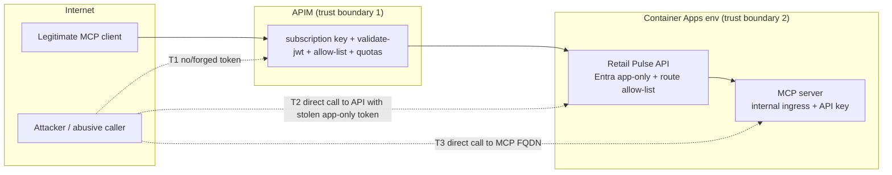

# ADR 017: Governed APIM MCP runtime and authentication boundary

- **Status:** Proposed (design only; becomes Accepted when the Squad lead signs off; implemented by the runtime issue under epic #321)
- **Issue:** #334 (parent #321, blocked-by #322)
- **Supersedes:** §2.6 "option (a)" of `docs/proposals/retail-ai-gateway-control-plane.md` (external MCP ingress restricted to APIM and a static API key). The proposal's governing goals (explicit read-only allow-list, subscription key plus Entra at the edge, no implicit tools) are kept.

## Context

- `ca-retailpulse-mcp` has `external: false` ingress and a static `X-Api-Key` secret (`infra/modules/container-apps.bicep`). APIM is public (`virtualNetworkType: None`, `infra/modules/apim.bicep`) and the Container Apps environment has no VNet, so APIM cannot reach the internal MCP app.
- The existing MCP attach-on does not inject `X-Api-Key`, so deploying it unchanged would produce 401s, or tempt us to weaken the server's key check.
- The public Retail Pulse API (`ca-retailpulse-api`) already validates tenant-pinned Entra JWTs and, when `MicrosoftEntra:AllowAppOnlyTokens=true`, accepts app-only (client-credentials / managed-identity) tokens that carry the `RetailPulse.User` app role, optionally restricted to `MicrosoftEntra:AllowedAppClientIds` (`src/RetailPulse.Api/Security/AuthenticationSetup.cs`, `EntraAuthOptions.cs`). The API already proxies to the internal MCP server using the key, including `GET /api/forecast` on the MCP server (used today by `ForecastTool`).

## Decision

**Expose the four approved read-only operations as MCP tools by having APIM "Expose REST API as MCP server" over the public Retail Pulse API. APIM authenticates to the API with its system-assigned managed identity (Entra app-only token). The internal `ca-retailpulse-mcp` app is not touched: it stays `external: false`, keeps its API key, and is never exposed or addressed by APIM.**

No static secret leaves the environment, no ingress changes, no APIM or environment VNet, no IP restriction. This is the "managed identity to the public API" pattern the issue prefers.

### Approved v1 tools (all `GET`, read-only)

| MCP tool name (APIM operation id) | Public API operation | Notes |
|---|---|---|
| `get_inventory` | `GET /api/supply/inventory` (`brand`, `region`, `category`, `status`) | Item-level stock; store/SKU identifiers only |
| `get_stockout_risk` | `GET /api/stores/stockout-risks` (`region`, `limit` clamped to 1–50, default 20) | Derived from inventory |
| `get_supply_disruptions` | `GET /api/supply/disruptions` (`brand`, `region`, `severity`, `activeOnly`) | |
| `get_demand_forecast` | `GET /api/demand/forecast` (`brand` required, `region` default `National`) | **New** thin endpoint (§Follow-on); calls the internal MCP server `GET /api/forecast` |

Everything else (`/api/supply/health`, `/api/supply/fulfillment`, margin, promo, plans, sessions, memory, admin, chat, approvals, hubs) is **not imported** into the MCP API. Retail Pulse data is synthetic retail data; v1 exposes no patient or customer records and no write operation.

### Caller authentication (client → APIM)

1. **Subscription key** required on the MCP API (`subscriptionRequired: true`, product `retailpulse-mcp`, header `Ocp-Apim-Subscription-Key`). The product is approval-required; keys identify the calling team for quotas and logs.
2. **`validate-jwt`** in the API inbound policy: Entra v2 issuer pinned to the tenant, audience `api://retailpulse-mcp-gateway` (new app registration, named value `mcpGatewayAudience`), and required app role claim `RetailPulse.Mcp.Invoke` (`roles`). `require-expiration-time`, `require-signed-tokens`, clock-skew 60s. Failure → 401 with no body detail.
3. The caller's `Authorization` header is **stripped** before the backend call; it is never forwarded.

### APIM → backend authentication

- `authentication-managed-identity resource="{{retailPulseApiAudience}}"` stores the token in a variable and sets a fresh `Authorization: Bearer` header (the policy runs after the caller header is removed). `retailPulseApiAudience` is the audience the API already validates (`MicrosoftEntra:ClientId`/`Audience`).
- The APIM managed identity service principal is assigned the API's app role `RetailPulse.User` (Graph `appRoleAssignment`, scripted in the runtime issue's post-provision hook).
- API configuration (Container App env vars): `MicrosoftEntra__AllowAppOnlyTokens=true`, `MicrosoftEntra__AllowedAppClientIds__0={apim MI appId}`. Any app-only token from another client is rejected by the existing policy.
- **Defense in depth (new):** `AppOnlyRouteAllowListMiddleware` in the API, specified exactly:
  - **Placement:** `UseRouting()` → `UseAuthentication()` → `UseAuthorization()` → `UseMiddleware<AppOnlyRouteAllowListMiddleware>()` → endpoint execution. It must run after routing so `HttpContext.GetEndpoint()` is resolved and the route template (`RouteEndpoint.RoutePattern.RawText`) can be read; "after `UseAuthentication`" alone is insufficient. It runs after authorization so unauthenticated requests are already rejected (401) and it can only narrow access.
  - **App-only detection:** a principal is app-only when it has **no** scope claim, using the same check as `HasScopeClaim` in `AuthenticationSetup.cs` (neither the short `scp` nor the long `http://schemas.microsoft.com/identity/claims/scope` claim type), **and** it has a `roles` claim. Delegated tokens (either claim form) bypass this middleware unchanged. `HasScopeClaim` is made `internal` and shared so the two checks cannot drift.
  - **`McpGateway:Clients:{i}` format:** per-client `ClientId` (azp/appid, GUID) plus `Operations`, an array of strings `"{METHOD} {route template}"`: upper-case method, one space, route template exactly as registered (method compared ordinally, template case-insensitively), e.g. `GET /api/supply/inventory`, `GET /api/stores/stockout-risks`, `GET /api/supply/disruptions`, `GET /api/demand/forecast`. Environment form: `McpGateway__Clients__0__ClientId` (APIM) and `McpGateway__Clients__0__Operations__0` … `__3`; slot 1 is the Teams bot (`POST /api/chat` only).
  - **Empty/missing behavior (fail closed):** an empty or absent list denies every app-only request with 403. A request with no resolved endpoint, or whose method/template is not an exact entry, also returns 403 with no detail body.
  - A compromised or mis-scoped APIM identity therefore cannot reach any other API route, and no write route is reachable by app-only tokens in v1.
- The backend `set-backend-service` targets `https://{{retailPulseApiFqdn}}` (named value from Bicep output); `forward-request timeout=30`. No policy reads `context.Response.Body`.

### Allow-listing, quotas, write denial

- **Tool allow-list:** only the four operations above exist in the MCP API (explicit operation list in Bicep; no wildcard operations, no implicit import). The APIM MCP `tools/list` therefore returns exactly four tools. Policy `choose` on `context.Operation.Id` rejects anything not in the set with 403 as a belt-and-braces check.
- **Write denial:** every operation is `GET`; policy returns 405 for any other method; the API middleware denies non-GET for app-only tokens. Adding any write tool requires a new ADR, an `approval-required` subscription scope, human-in-the-loop approval in the caller, and a dedicated app role. None are in v1.
- **Quotas (per subscription key):** `rate-limit-by-key` 30 calls/60 s; `quota-by-key` 2,000 calls/day and 20 MB/day bandwidth (`counter-key=@(context.Subscription.Id)`). 429 returns `Retry-After`.
- **Response-size cap (API-side, not APIM):** Microsoft documents that MCP server policies must not read `context.Response.Body` (it forces buffering and breaks MCP streaming), and `forward-request` has no response-size limit, so APIM cannot enforce a payload cap. The cap lives in the Retail Pulse API: each of the four v1 endpoints limits results to `McpGateway:MaxItems` (default 50; `limit` on stockout risks clamped to 1–50) and enforces `McpGateway:MaxResponseBytes` (default 262144) through an endpoint filter that, for app-only callers, serializes the result and returns `413` with `{"error":"response_too_large"}` if the budget is exceeded. Pass/fail: a test seeding more than the limit gets ≤ 50 items, and an oversize payload gets 413. The `quota-by-key` bandwidth quota is the aggregate backstop.
- **Logging:** APIM diagnostics (existing `GatewayLogs`) record subscription id, operation id, status; request/response bodies are not logged; `Authorization` and `Ocp-Apim-Subscription-Key` headers are excluded from diagnostics.

### Transport and SKU (resolved, single path)

The Developer SKU is retained and supported: Microsoft Learn's "Expose REST API as MCP server" lists **Developer, Basic, Basic v2, Standard, Standard v2, Premium, Premium v2** under "Applies to" (https://learn.microsoft.com/azure/api-management/export-rest-mcp-server). The transport is the APIM-native MCP server over a managed REST API (tools only; resources and prompts are unsupported, and v1 needs neither). There is **no REST fallback**: a plain REST API at `/mcp-rest/*` does not deliver MCP tools and is not an approved path.

Fail-closed rule: if the MCP server resource cannot be created on the deployed instance, or `tools/list` does not return exactly four tools, the runtime issue **fails acceptance** and does not ship. No REST or other transport substitute is deployed and no ingress is opened. Changing SKU or transport requires a new ADR. The runtime issue verifies the Bicep resource type/API version for APIM MCP servers (`az bicep build`) and records it in `apim-mcp-api.bicep`.

### Identity provisioning (one hook, idempotent)

The azd `postprovision` hook (`azd-hooks/postprovision.ps1`/`.sh`, already wired in `azure.yaml`) calls new `scripts/Setup-McpGatewayIdentity.ps1` (the `.sh` wrapper runs it with `pwsh`). This is the only provisioning path. It uses Microsoft Graph as the deploy identity and is safe to re-run:

1. Find the gateway app registration by identifier URI `api://retailpulse-mcp-gateway`; create it with app role `RetailPulse.Mcp.Invoke` (`allowedMemberTypes: ["Application"]`) only if missing, add the role only if absent, and ensure its service principal exists.
2. Resolve the Retail Pulse API service principal and its `RetailPulse.User` app role id.
3. Resolve the APIM system-assigned managed identity service principal (`principalId` from the Bicep output) and create the `appRoleAssignment` for `RetailPulse.User` only if no identical (principal, resource, appRoleId) assignment exists.
4. Emit the gateway audience and the APIM MI `appId` as azd env values consumed by the Container App settings (`MicrosoftEntra__AllowedAppClientIds__0`). No secret is created or output.

**Required Graph permissions for the deploy identity** (admin-consented): `Application.ReadWrite.All` (create/update the gateway app registration and its role) and `AppRoleAssignment.ReadWrite.All` (assign `RetailPulse.User` to the APIM MI service principal). The Cloud Application Administrator directory role covers both for interactive deployers. `Application.ReadWrite.OwnedBy` is not sufficient (it cannot create app-role assignments).

**Failure behavior:** fail-closed (`continueOnError: false`). On 403/`Authorization_RequestDenied` the script exits non-zero naming the missing Graph permission; it does not skip the assignment. `MicrosoftEntra__AllowAppOnlyTokens` is set from the script's success output, so it stays `false` unless step 3 succeeded. Transient 429/5xx are retried 3 times with backoff; a 404 from service-principal propagation delay is retried up to 5 times at 10 s intervals, then fails.

## Sequence

```mermaid
sequenceDiagram
    autonumber
    participant C as MCP client (agent/IDE)
    participant E as Entra ID
    participant G as APIM (MCP API)
    participant M as APIM managed identity
    participant A as Retail Pulse API (public)
    participant S as MCP server (internal, X-Api-Key)
    C->>E: client credentials (aud api://retailpulse-mcp-gateway)
    E-->>C: JWT with role RetailPulse.Mcp.Invoke
    C->>G: tools/call get_inventory + subscription key + JWT
    G->>G: validate subscription, validate-jwt, tool allow-list, GET only
    G->>G: rate-limit-by-key / quota-by-key
    G->>M: acquire token for API audience
    M->>E: managed identity token request
    E-->>G: app-only JWT (role RetailPulse.User)
    G->>A: GET /api/supply/inventory (Bearer app-only JWT; caller token removed)
    A->>A: JwtBearer + AllowedAppClientIds + route allow-list middleware
    A->>S: GET /api/supply/inventory (X-Api-Key, internal)
    S-->>A: JSON
    A-->>G: JSON
    G-->>C: tool result
```

## Threat model



| # | Threat | Mitigation | Residual |
|---|---|---|---|
| T1 | Unauthenticated / forged / replayed caller token | Subscription key and pinned-issuer `validate-jwt` with audience and role; short token lifetime | Leaked key + valid token = full v1 read access; bounded by quotas and key rotation |
| T2 | Stolen or other-tenant/other-client app-only token against the API | `AllowedAppClientIds` pins the APIM MI; route allow-list rejects every non-v1 route and method | Token for the MI is only issuable to APIM; it can read the four routes |
| T3 | Direct call to the MCP server | Ingress stays internal; key retained; APIM never targets it | None new |
| T4 | Tool injection / unapproved tools (e.g. write tools) | Explicit operation list, GET-only policy, API middleware, ADR required for any addition | Review discipline |
| T5 | Prompt injection via tool output | Existing tool-result content-safety policy (ADR 015) applies in the agent; outputs are numeric/structured | Caller-side agents must treat results as untrusted data |
| T6 | Denial of wallet / scraping | Per-key rate limit, daily quota, `limit` clamp, response size cap | Within quota data volume |
| T7 | Secret sprawl | No static secret for APIM→backend; named values only hold non-secret audiences/FQDNs; subscription keys managed by APIM | — |
| T8 | Sensitive data exposure | v1 data set contains no patient/customer records; no bodies in logs | Contract test asserts schemas |

## Alternatives rejected

1. **External MCP ingress restricted to APIM egress IP + static key (proposal option a).** Developer SKU public IP is shared/ changeable, IP allow-lists are weak identity, static secret must be copied into APIM named values/Key Vault, and it widens the attack surface of a service designed to be internal.
2. **VNet-inject APIM and the Container Apps environment.** The production-credible long-term network answer, but requires a SKU change and a destructive environment recreation; out of scope for this epic. Retained in the production table of the proposal.
3. **Deploy the existing attach-on unchanged.** Cannot reach the internal app and sends no key; rejected by the issue.
4. **Make the MCP server public with Entra validation of its own.** Duplicates the auth stack in a second service and still exposes write-capable tools surface (`UpdateMetrics`) on the internet.
5. **Per-tool Entra delegated user tokens end to end.** Overkill for read-only demo data; the gateway identity plus caller roles gives the needed attribution via subscription id.

## Follow-on implementation surfaces (runtime issue)

| Surface | Change |
|---|---|
| `infra/modules/apim-mcp-api.bicep` (new) | MCP API, four operations, product `retailpulse-mcp`, named values (`retailPulseApiFqdn`, `retailPulseApiAudience`, `mcpGatewayAudience`, tenant id) |
| `infra/modules/apim-mcp-policy.xml` (new) | `validate-jwt`, strip `Authorization`, GET-only, operation allow-list, rate/quota, `authentication-managed-identity`, `set-backend-service` |
| `infra/main.bicep`, `infra/main.bicepparam` | Wire module; pass API FQDN/audience; outputs `AZURE_APIM_MCP_ENDPOINT` |
| `infra/modules/container-apps.bicep` | API env vars `MicrosoftEntra__AllowAppOnlyTokens`, `MicrosoftEntra__AllowedAppClientIds__0`, `McpGateway__Clients__*`; **MCP server ingress unchanged** |
| `src/RetailPulse.Api/Security/AppOnlyRouteAllowListMiddleware.cs` (new), `AuthenticationSetup.cs`, `Program.cs` | Route/method allow-list for app-only tokens, registered after `UseRouting`/`UseAuthentication`/`UseAuthorization`; `HasScopeClaim` made `internal`; response-size filter |
| `src/RetailPulse.Api/Endpoints/DemandEndpoints.cs` (new) | `GET /api/demand/forecast?brand=&region=`: `brand` required (400 if blank), `region` default `National`; uses `IHttpClientFactory.CreateClient("McpServer")` and calls `GET /api/forecast?brand={brand}&region={region}` (both `Uri.EscapeDataString`), the same call `ForecastTool` makes. It does **not** use `ForecastTool` (marked `[Obsolete]`, and it turns failures into a 200 fallback body); backend failure returns 502 |
| `src/RetailPulse.Api/Endpoints/StoreEndpoints.cs` | Preserve the existing 1–50 `limit` clamp on `/api/stores/stockout-risks` and pin it with targeted tests |
| `src/RetailPulse.Api/Endpoints/SupplyEndpoints.cs` | Apply `McpGateway:MaxItems` cap to `/api/supply/inventory` and `/api/supply/disruptions` |
| `azd-hooks/postprovision.ps1`/`.sh`, `scripts/Setup-McpGatewayIdentity.ps1` (new) | Single idempotent identity provisioning path (see above) |
| `tests/RetailPulse.Tests/` | Middleware tests (allowed GET, denied POST, denied other route, empty list denies all, both scope claim forms treated as delegated, delegated unaffected); stockout `limit` clamp test (0, 51, 1000, default); forecast endpoint tests (missing brand 400, backend URL/params, backend failure 502); size-cap 413 test; Bicep/policy contract tests under `Deployment` asserting no wildcard operations, GET-only, quotas present, no `X-Api-Key` named value |
| `docs/MCP-TOOLS.md`, `docs/security.md`, `docs/authentication-matrix.md` | Document the gateway path (proposal §2.6 already points here) |

## Acceptance checks for the runtime issue

- Direct call to the MCP FQDN from the internet fails (no ingress); direct call to the API with no token or a token from another client fails (401/403).
- `tools/list` via APIM returns exactly the four tools; `POST` or any non-listed operation returns 403/405.
- Exceeding rate/daily quota returns 429.
- No static MCP key appears in APIM configuration.
- An app-only token issued to a **different client** (not the APIM MI) → 401/403 at the Retail Pulse API (`AllowedAppClientIds`) and at the APIM MCP endpoint (`validate-jwt` audience/role).
- The APIM MI token used on a **non-v1 route or non-GET method** (e.g. `GET /api/margin/risks`, `POST /api/supply/inventory`) → 403 from the route allow-list middleware; a caller with no matching `McpGateway:Clients` entry is denied; the bot token on a v1 route is denied too.
- **No `X-Api-Key`/MCP key** in APIM named values, policy XML, or Bicep outputs (contract test inspects the compiled template and outputs; named values hold only audiences/FQDNs/tenant id).
- `tools/list` count == 4 (exactly `get_inventory`, `get_stockout_risk`, `get_supply_disruptions`, `get_demand_forecast`) on the Developer SKU, else acceptance fails (no REST fallback).
- `GET /api/stores/stockout-risks?limit=1000` returns ≤ 50 items; an oversize payload for an app-only caller returns 413.
- `Setup-McpGatewayIdentity.ps1` run twice creates no duplicate app registration, role or assignment, and exits non-zero naming the missing permission when run without the Graph permissions.
